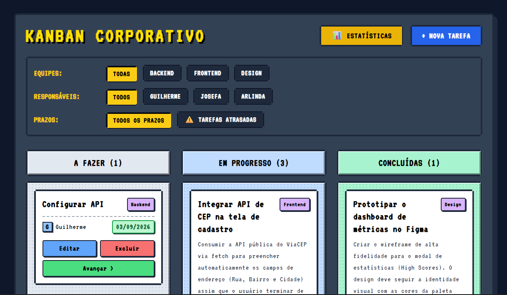
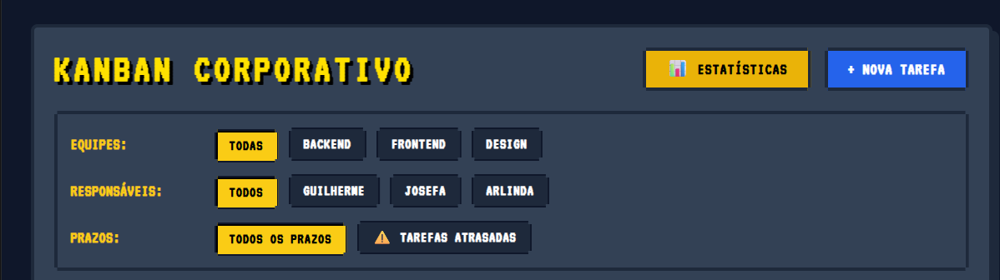
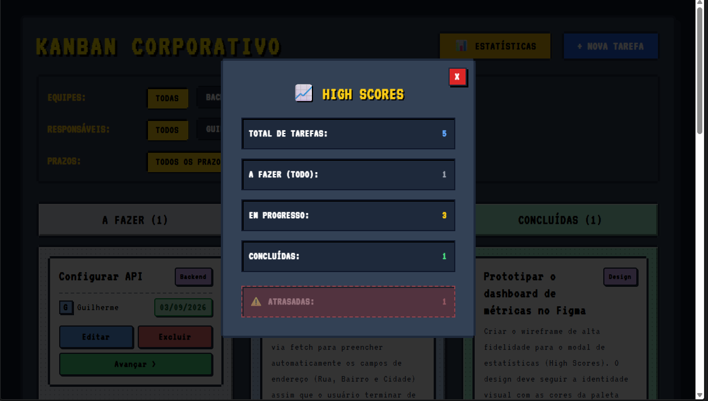
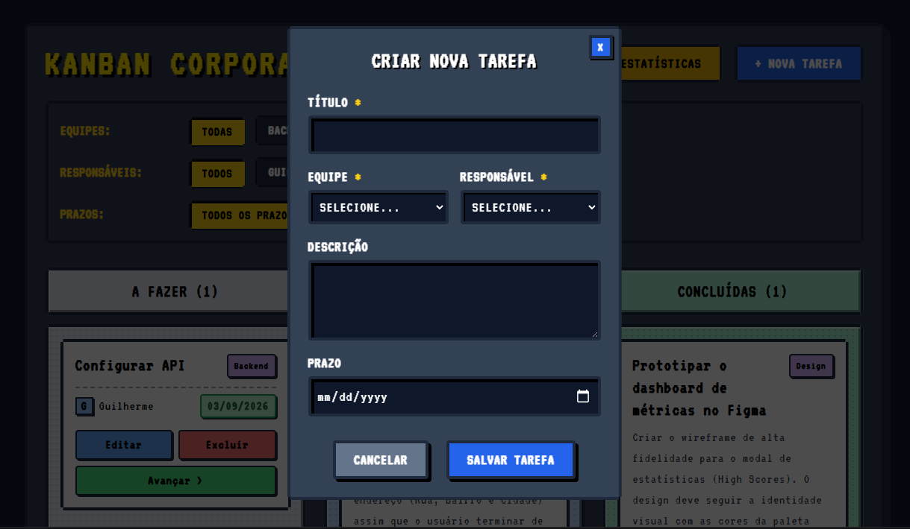

# 🕹️ Kanban Corporativo Full-stack

Aplicação de gerenciamento de tarefas no estilo Retro/Pixel Art desenvolvida como projeto de portfólio para demonstrar habilidades em desenvolvimento Full-stack (Java + React).

## 🚀 Tecnologias Utilizadas

* **Back-end:** Java 17, Spring Boot, Spring Data JPA, PostgreSQL, Maven.
* **Front-end:** React, Vite, Tailwind CSS (com estilização customizada Pixel Art).

## 📸 Demonstração do Sistema

| Visão Geral do Painel | Filtros Dinâmicos |
| :---: | :---: |
|  |  |

| Estatísticas (High Scores) | Criação / Edição de Tarefas |
| :---: | :---: |
|  |  |

## ⚙️ Funcionalidades Principais
* **CRUD Completo de Tarefas:** Criação, edição, exclusão e alteração de status via Drag-and-Drop ou botões de navegação.
* **Filtros Avançados:** Filtragem dinâmica por equipes e responsáveis integrada diretamente com a API.
* **Regras de Negócio e Métricas:** Painel estatístico para acompanhamento de tarefas totais, concluídas e alertas automáticos para prazos atrasados.
* **Relacionamentos de Banco:** Mapeamento robusto entre Tarefas, Equipes e Usuários (`@ManyToOne`).

## 🛠️ Como Executar o Projeto

### 1. Clonar o repositório
```bash
git clone [https://github.com/Guiga14/kanban-corporativo-fullstack.git](https://github.com/Guiga14/kanban-corporativo-fullstack.git)